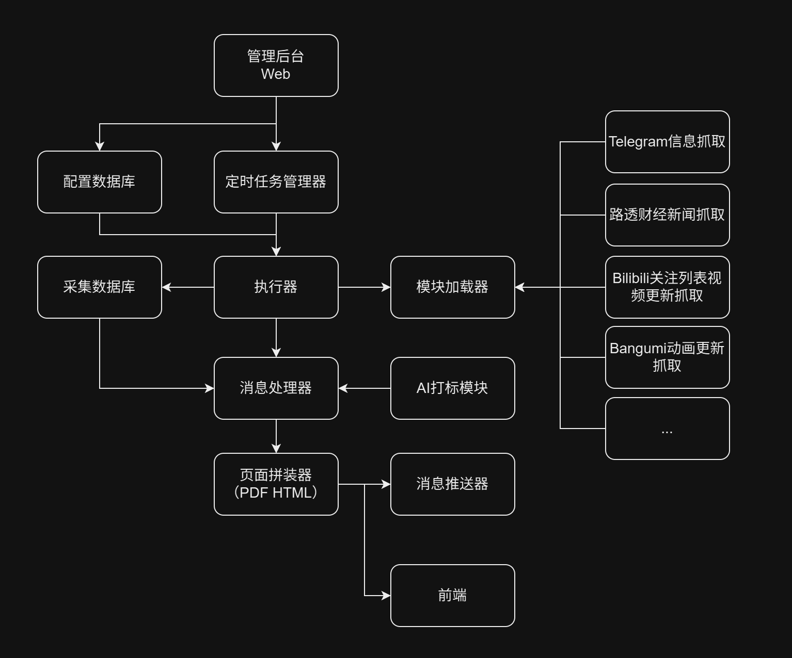
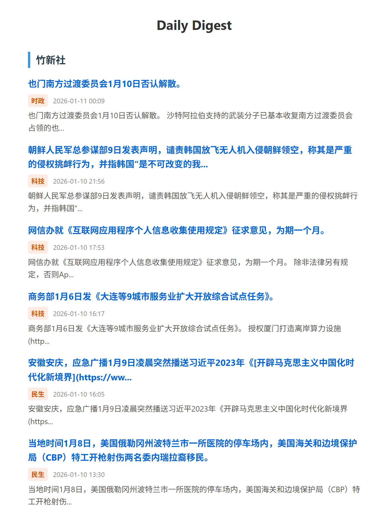
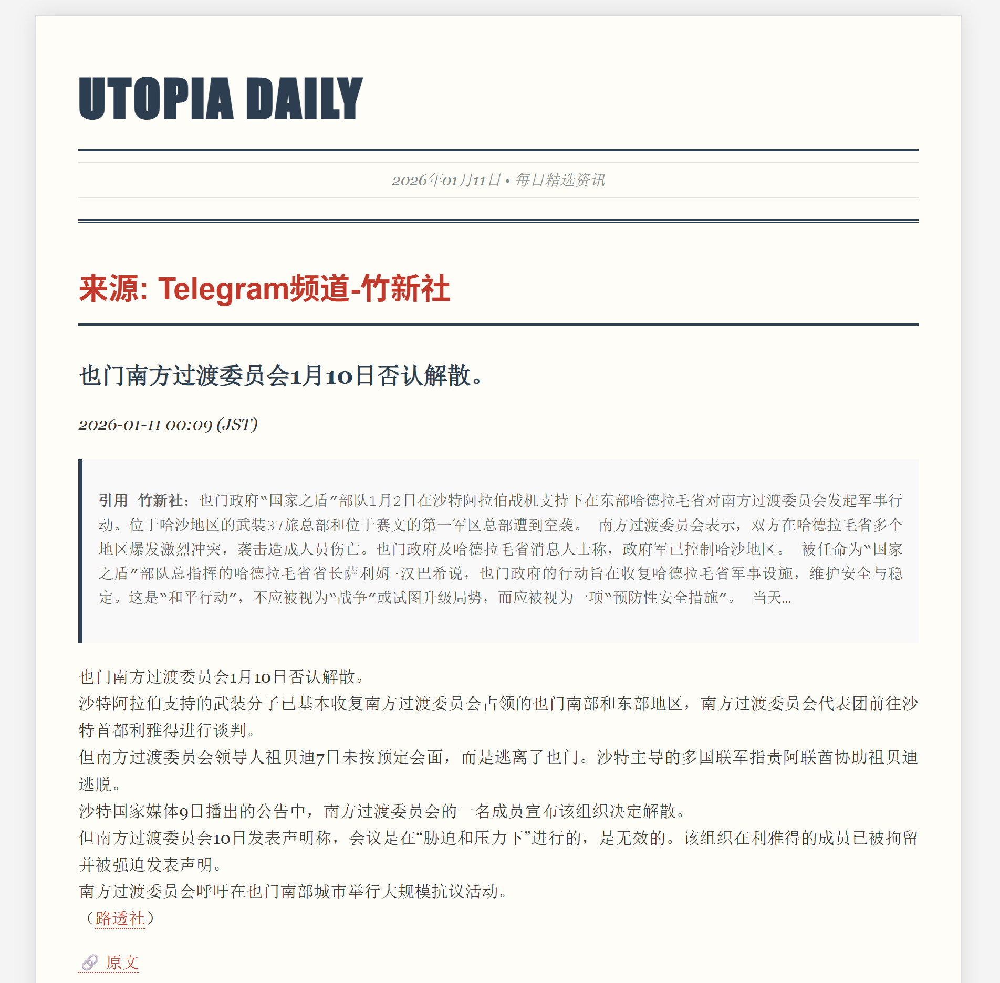

# Utopia Daily

WIP  

这是一个开发中的项目。旨在进行新闻获取与分析。支持模块化加载和可视化配置网页。支持AI打标分析。    
灵感来源：[TrendRadar](https://github.com/sansan0/TrendRadar)  
<br>
本项目目标是构建一个大型的可拓展的模块化系统，而非易于部署。前期将仅提供docker与直接运行的部署方式。  
<br>
由于我的目标是在我一个i5-8350U的上古Ubuntu Server系统的老旧笔记本上运行本程序，因此设定以下技术目标：  
最低运行环境：1H CPU（400GFLOPS/H），1G内存，1G磁盘空间（包含docker镜像大小）  
推荐运行环境：4H CPU，2G内存，10G磁盘空间。  
<br>
警告：本项目大量使用Gemini等生成式AI。开发工具：PyCharm + Gemini Code Assist插件 + Copilot插件  
<br>
警告：目前代码均为测试用途，还没有完成全部基本业务逻辑的实现，请不要fork，pr等。  
<br>
20260118晚：用LLM调了半天Transformer模型的参数和调用方法，我感觉现在的AI分类方法已经堪用了。我个人是不太懂AI这方面的算法的，完全是靠着经验和Gemini了。只能说勉强能用了吧，大体上没啥问题但是细节上分错类的也蛮多的。对我来说可能以后要是想再优化AI分类算法这块，就只能先用Transformer先分析一遍，然后给结果通过MCP扔给LLM了。不过我感觉其实用CPU跑个1B的模型效果是不是能比我现在调试用的E5-Small Multilingual好用呢。  
<br>
20260119下午：里程碑，项目已完成一半功能。希望新年前能发布第一版。  

## 免责声明
本项目为通用数据处理架构，旨在提升信息索引效率。严禁利用本框架开发任何违反当地法律法规（如侵犯版权、非法获取计算机信息系统数据等）的插件或模块。

本仓库不对任何基于此框架开发的第三方插件的合法性负责。用户在使用过程中产生的任何法律风险与后果，概与本仓库贡献者无关。使用本框架请在下载后 24 小时内删除且只能用于合规的技术研究，切勿用于非法用途。
## 初期开发计划
- [x] 架构设计
- [x] Android-Like Logger
- [x] i18n框架
- [x] 抓取模块加载器
- [x] 数据库配置
- [x] 事件管理器
- [x] 文件缓存工具
- [ ] 信息推送模块加载器
- [ ] 定时任务
- [x] 控制面板架构与相关数据库设计
  - [x] 登录
  - [x] 总览
  - [x] 系统配置
  - [x] 用户配置
  - [x] 抓取模块配置
  - [x] 分类模型下载器
  - [x] 通用分类标签配置
  - [ ] 信息推送模块配置
  - [ ] 定时任务配置
  - [ ] 表示用前端配置
  - [ ] 个人推送配置
- [ ] HTML 拼装
- [x] AI 分类打标
- [ ] 表示用前端
- [ ] 审阅 AI 代码

## 稳定后的开发计划
- [ ] MCP 支持


## 抓取模块开发计划
爬虫开发具有极大法律风险。仓库主线只接受无风险模块。  
### 已计划
- [x] Telegram 公共频道
- [ ] Bilibili 指定UP主更新与热榜
- [ ] Bangumi 更新
- [ ] 微博热榜
- [ ] RSS

### 其他
如有需要，请自行开发插件。  


## 消息通知渠道模块开发计划
### 已计划
- [ ] 邮件
- [ ] 短信（SMS）
- [ ] webhook

### 无计划
- 微信
- 自行开发 APP

### 其他
如有需要，请自行开发插件。 


## 文档计划
本README目前仅用作开发记录，不作为项目文档。  
当项目整体开发完成，考虑使用VuePress进行文档编写。项目README只保留英语基本信息。  
已计划的文档：使用说明、模组开发指南

## 开发阶段调试方法
### 直接调试
```bash
cd ${base_path}/Utopia-Daily
pip install -r requirements.txt
cd src/web/dashboard/frontend
npm run build
cd ${base_path}/Utopia-Daily/src
python app.py
# localhost:8000
# 修改数据库迁移或数据库设计后需删除数据库文件再启动（开发阶段）
```

### Docker 调试
```bash
cd ${base_path}/Utopia-Daily
docker build -f docker/Dockerfile -t utopia-daily .
docker run -d -p 8000:8000 utopia-daily
# localhost:8000
```

## 架构


## Demo图
### Email Digest


### Full Page
